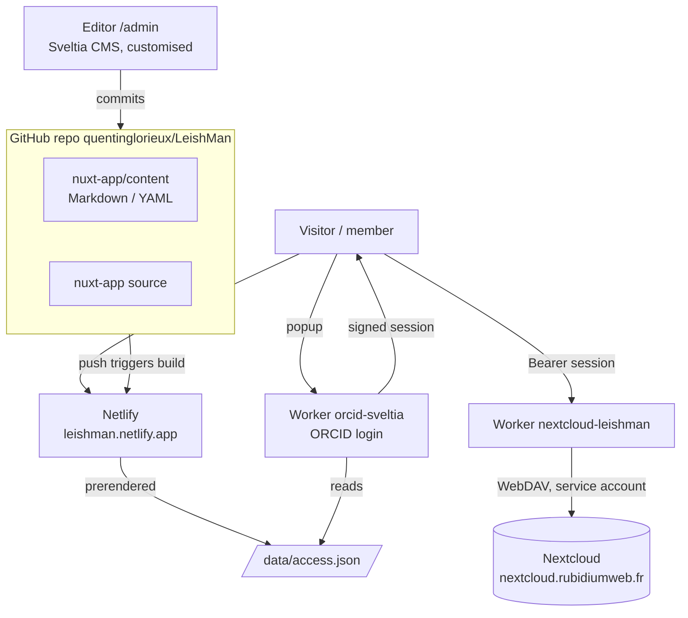

---
search:
  exclude: true
---

# How the website works

!!! info "Restricted section"
    These pages are password protected and excluded from the site search.



## Repository layout

| Path | Content |
|---|---|
| `nuxt-app/` | The website (Nuxt 4, Nuxt UI 4, Nuxt Content 3, Tailwind 4). Built by Netlify with `npm run build` (preset `netlify`, SSR). |
| `nuxt-app/content/` | All content, one Markdown/YAML file per entry. Schemas in `nuxt-app/content.config.ts`. |
| `nuxt-app/public/admin/` | The editor: `config.yml` (collections and fields) and the customised Sveltia build in `dist-0.129/`. |
| `nuxt-app/public/data/users/` | `admin.yml` (administrators) and `viewer.yml` (extra access). Edited in *Access & roles*. |
| `nuxt-app/server/` | `routes/data/access.json.ts` + `utils/access.ts`: the access map, prerendered at build time. |
| `sveltia-src/` | Source of the customised Sveltia CMS 0.129 (ORCID login, DOI import, Nextcloud page, roles). `pnpm run build` (Node ≥ 22.13) copies the bundle into `nuxt-app/public/admin/dist-0.129/`. |
| `cloudflare-workers/` | Source of the two Cloudflare workers, shared session code and tests. |
| `docs/` | This documentation (MkDocs Material). |

## Working groups and members

- `content/members/<stem>.md`: one person (`firstname`, `lastname`, `orcid`, `laboratory`, `thumbnail`, `steering`, `coordinator`...).
- `content/projects/<group>.md`: `folder` (Nextcloud top-level folder) and `members: [{member: <stem>, leader: bool}]`, where `member` is the file name of the member page.
- The steering committee page shows members with `steering: true`; the contact page those with `coordinator: true`.

## Access map

`/data/access.json` is generated by `server/utils/access.ts`:

```json
{
  "version": 1,
  "folders": { "VL-treatment": { "title": "VL treatment in immunocompromized group", "path": "VL-treatment" } },
  "users": {
    "0000-0002-1825-0097": { "firstname": "Josiah", "lastname": "Carberry", "role": "viewer", "folders": ["VL-treatment"] }
  }
}
```

Rules: group membership (with a valid ORCID iD) + `viewer.yml` extra access + `admin.yml` (role `admin`, folders `["*"]`). Legacy group labels (`LV`, `Diagnostic`...) are mapped to folder names.

## Login and documents

1. The page opens `orcid-sveltia /auth/orcid?origin=<page origin>&mode=site|cms`. The origin must match `ALLOWED_ORIGINS`.
2. After ORCID login, the worker looks the ORCID iD up in `access.json` and returns, by `postMessage` to that origin only: profile, folders and a **session token** signed with `SESSION_SECRET` (HMAC-SHA256, valid 12 h). Admins and editors also receive the GitHub token used by the editor.
3. The page stores the session in `localStorage` (`leishman.session`) and sends it as `Authorization: Bearer` to `nextcloud-leishman`.
4. `nextcloud-leishman` verifies the signature and expiry, then only serves paths whose first segment is in the session's folders. Writes (upload, create, delete, share links) are admin only.

## Local development

```bash
cd nuxt-app && npm install && npm run dev            # http://localhost:3400
# with local workers:
cd cloudflare-workers/nextcloud-leishman && npx wrangler dev --port 8787   # needs .dev.vars
NUXT_PUBLIC_WORKER_BASE=http://localhost:8787 npm run dev
# worker tests (worker running locally):
cd cloudflare-workers && node --env-file=<file with SESSION_SECRET> test/nextcloud.test.mjs
```
