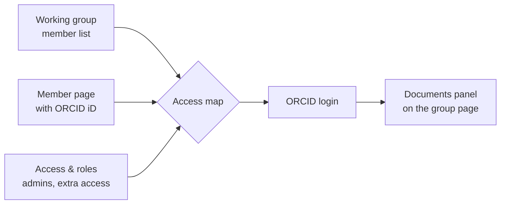
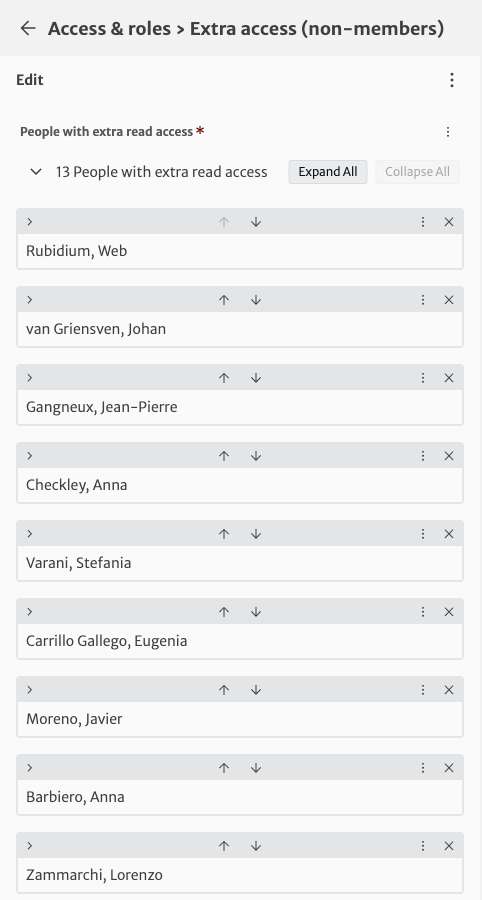

# Who can read which documents

Access to the private group folders is computed automatically each time the website is rebuilt (after every save in the editor).

A person can read a group folder when **one** of these is true:

1. they are in the group's **Members** list **and** their member page has an **ORCID iD**;
2. they are listed in **Access & roles > Extra access (non-members)** for that folder;
3. they are an **administrator** (administrators read every folder).

## Access & roles

- **Administrators**: can use the editor, read every folder and manage files. Keep this list short.
- **Extra access (non-members)**: read access to some folders for people who are not group members (for example an external reviewer). Each person needs an ORCID iD.

!!! note "Do I still need the extra access list?"
    Usually not: put people in the working group instead. The extra access list was the only mechanism before November 2026; some of its entries are now redundant (see the access report from the website manager).

## Checking the result

The list that is actually used is published at [`/data/access.json`](https://leishman.netlify.app/data/access.json): for each ORCID iD, the role and the folders. E-mail addresses are not included.
