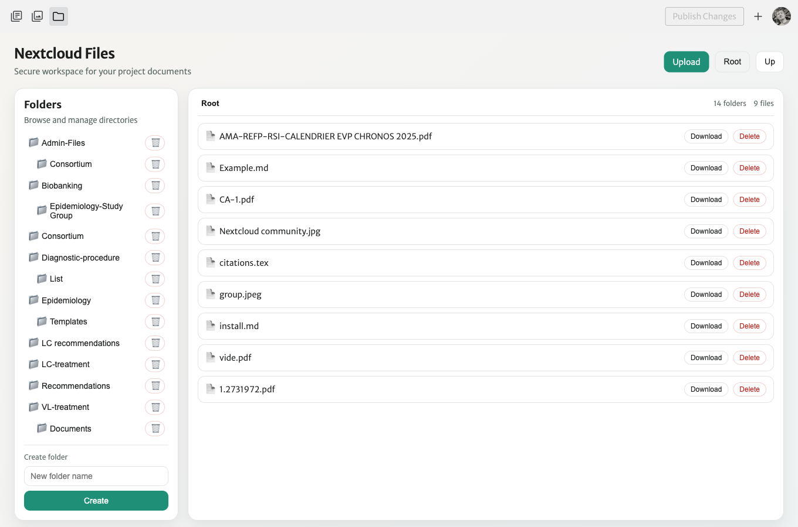

# Files on Nextcloud

Administrators can manage the group folders from the editor: click the :material-folder: icon at the top of the editor.

- Click a folder to open it, **Up** / **Root** to go back.
- **Upload** adds a file to the current folder.
- **Create folder** creates a sub-folder in the current folder.
- :material-delete: deletes a file or a sub-folder. The top-level group folders cannot be deleted from the website.

Group members only *read* the files: uploading, creating and deleting are reserved to administrators.

!!! info "New working group, new folder"
    The **Documents folder** list of a working group only offers existing top-level folders. To add one, ask the website manager to create it on Nextcloud and add it to the list in the editor configuration.
