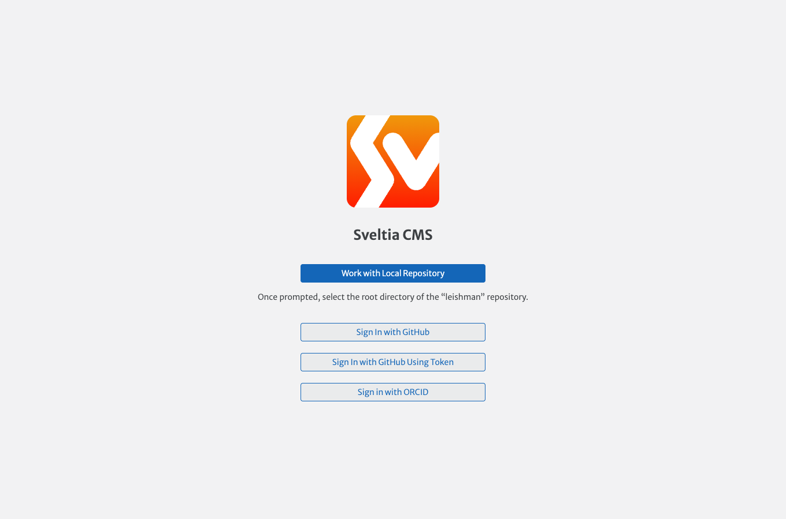
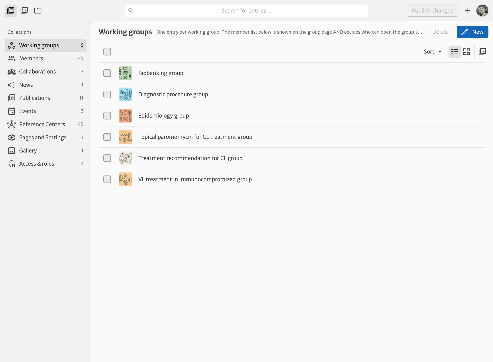

# Signing in to the editor

The website content (news, events, working groups, members...) is edited in the **editor** (Sveltia CMS) at [`/admin/`](https://leishman.netlify.app/admin/).

Click **Sign in with ORCID**. Only **administrators** and **editors** can enter the editor. Group members without editing rights get a message pointing them to the website instead.

## A quick tour

- The left column lists the **collections** (types of content). Each one has a short description at the top explaining what it is for.
- Click an entry to edit it. The right half of the screen shows a preview.
- **Save** publishes the change: the website is rebuilt automatically and the change is visible after **2 to 5 minutes**.
- The :material-folder: icon at the top opens the **Nextcloud files** manager (see [Files on Nextcloud](files.md)).

!!! warning "Every save is published"
    There is no draft step: saving an entry updates the public website. Each save is recorded in the project history (GitHub), so a mistake can always be undone by the website manager.
