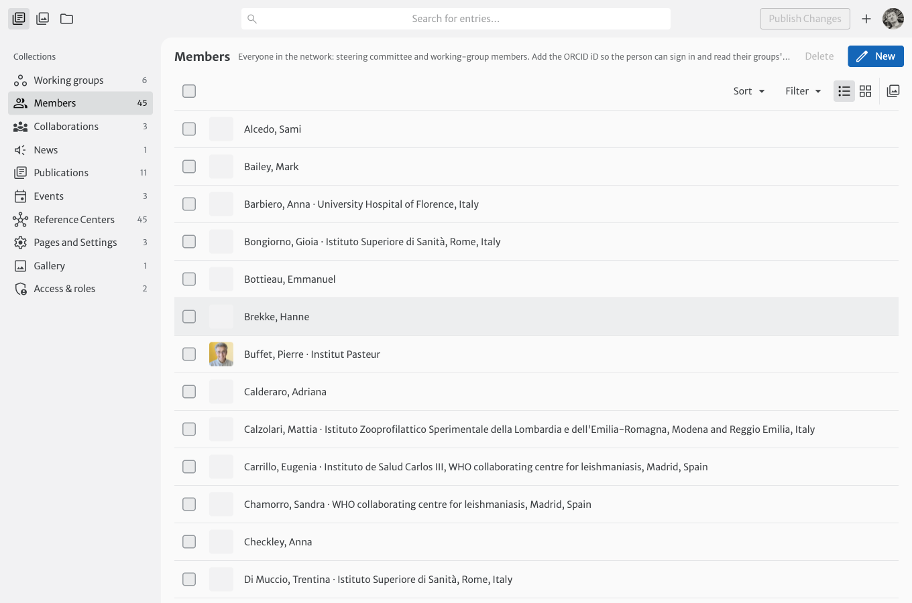
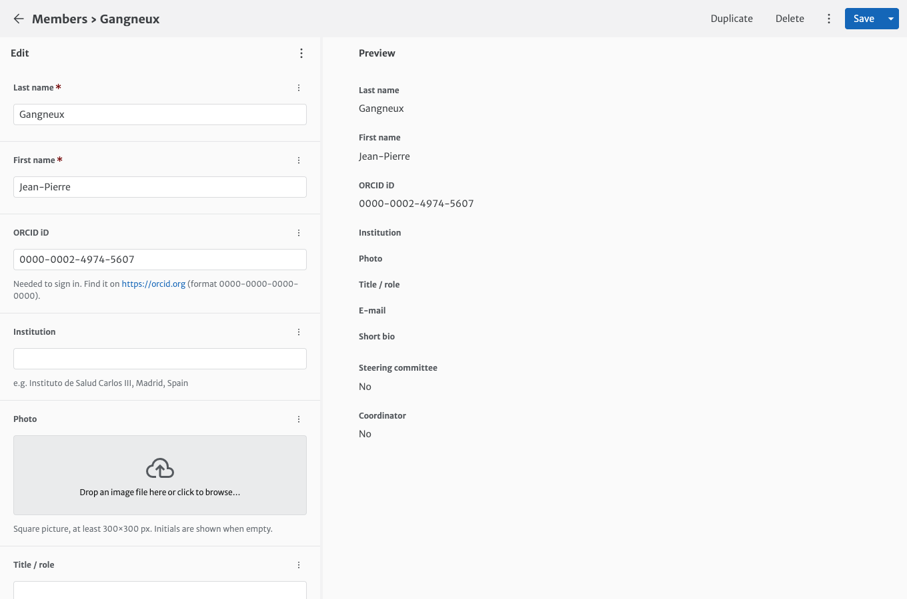

# Members

**Members** holds one page per person in the network: steering committee and working-group members.

The list shows the institution next to the name. Use **Filter** to show only the steering committee, or the people **without ORCID iD** (they cannot sign in yet).

## Adding a member

1. In **Members**, click **New**.
2. Fill in **Last name**, **First name** and, if possible, **ORCID iD** and **Institution**.
3. Click **Save**.
4. Add the person to their working group(s) ([how](working-groups.md#adding-or-removing-a-member)).

| Field | Notes |
|---|---|
| **ORCID iD** | Format `0000-0002-1825-0097`, without `https://orcid.org/`. Needed to sign in and read the group documents. The editor refuses an incorrect format. |
| **Institution** | Shown under the name on the group pages. |
| **Photo** | Square picture, at least 300×300 px. When empty, coloured initials are shown. |
| **Title / role** | For example *MD, PhD*. Shown on the steering committee page. |
| **E-mail** | Public: only shown on the Steering committee and Contact pages. |
| **Steering committee** | Shows the person on the Steering committee page. |
| **Coordinator** | Shows the person on the Contact page. |

!!! tip "Finding someone's ORCID iD"
    Search their name on [orcid.org](https://orcid.org/orcid-search/search) and check the affiliation. When in doubt, ask the person: a wrong ORCID iD gives access to someone else.
