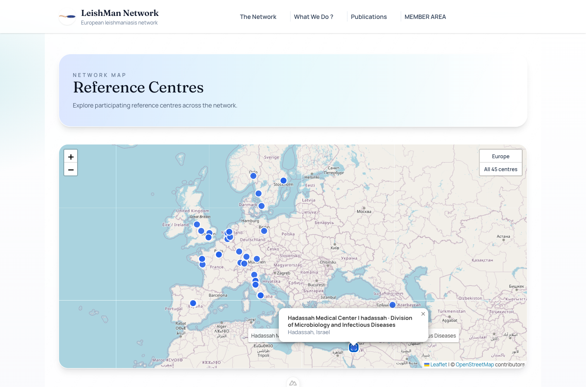

# Other content

| Collection | Where it appears |
|---|---|
| **News** | Home page and news list. |
| **Events** | Seminars / meetings page, with an optional programme (list of talks) and PDF. |
| **Publications** | Publications page. Use **Import from DOI** to fill the fields automatically from the DOI (CrossRef). |
| **Collaborations** | Collaborations page. |
| **Reference Centers** | Map and table of the Reference centres page. **Latitude** and **Longitude** place the point on the map (get them by right-clicking the place on [openstreetmap.org](https://www.openstreetmap.org) > *Show address*). |
| **Pages and Settings** | Texts of the Home, About and Contact pages. |
| **Gallery** | Pictures of the gallery page. |

