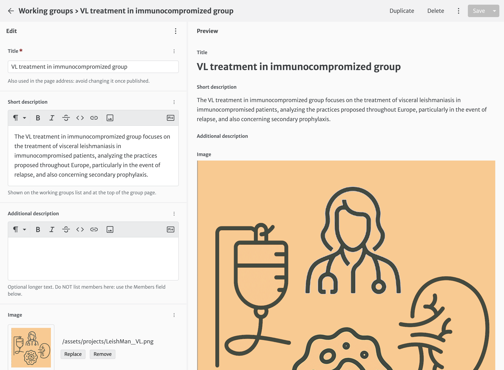
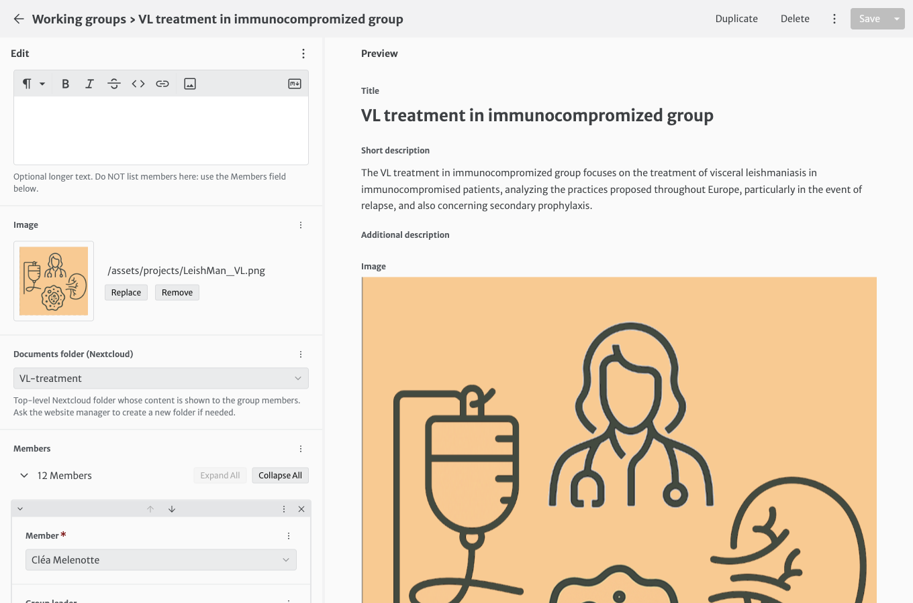

# Working groups

Each working group has one entry in **Working groups**. It drives the group page on the website: description, member cards and the private documents panel.

| Field | What it does |
|---|---|
| **Title** | Group name. It is also part of the page address, so avoid changing it once published. |
| **Short description** | Shown on the working groups list and at the top of the group page. |
| **Additional description** | Optional longer text. Do not list members here. |
| **Image** | Round icon next to the title. |
| **Documents folder (Nextcloud)** | The group's folder. Its content is shown to the group members. |
| **Members** | The member list (see below). |

## Adding or removing a member

1. Scroll to **Members**. Each item is one person, picked from the **Members** collection.
2. To add someone: click **Add** at the bottom of the list, then choose the person in the **Member** drop-down (type a few letters of the name or institution to search).
3. Switch **Group leader** on for group leaders. Leaders are shown first on the website, with a badge.
4. To remove someone: click the :material-close: on their item.
5. Use the arrows to change the order (leaders always come first on the website).
6. Click **Save**.

!!! info "The person is not in the drop-down"
    Create their page first in **Members** ([how](members.md#adding-a-member)), then come back to the group.

!!! success "Access to the documents follows automatically"
    Adding a person here also gives them read access to the group folder, **provided their member page has an ORCID iD**. Removing them removes the access at their next login.
