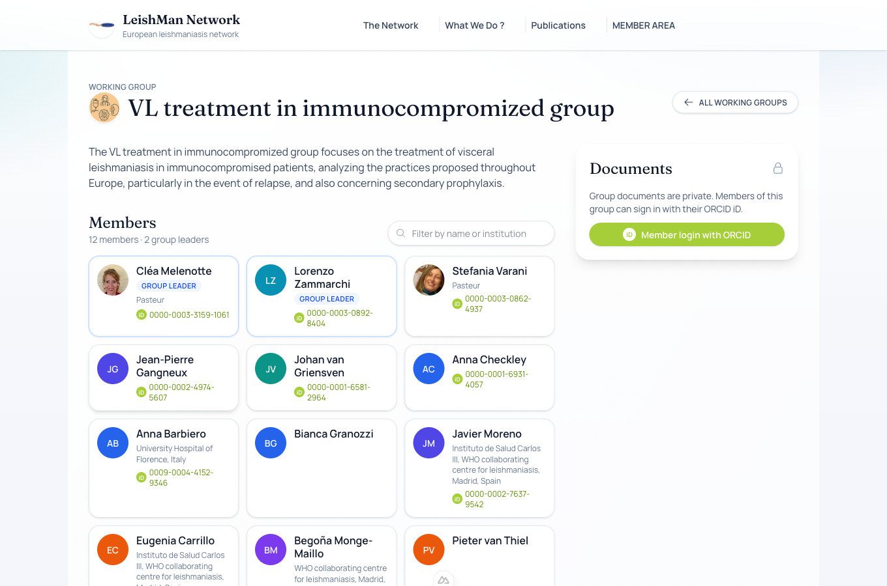
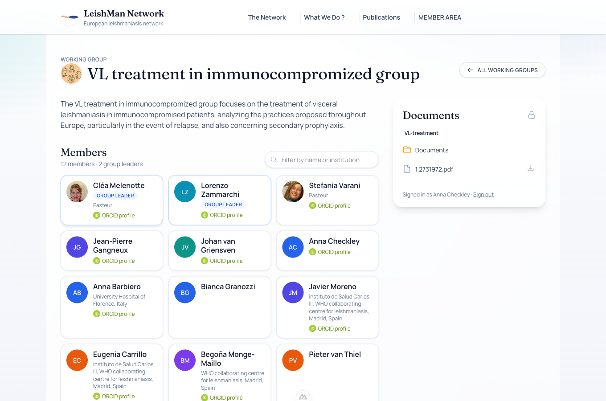

# Reading your group's documents

Each working group has a private folder (hosted on the network's Nextcloud). Members of the group can read it directly from the group page on the website.

## What you need

- An **ORCID iD** ([create one for free](https://orcid.org/register) if you do not have one).
- Your ORCID iD must be on your **member page** on the website. If you are listed in a group but cannot sign in, send your ORCID iD to the coordinators (see [below](#i-am-not-registered)).

## Step by step

1. Open the website, go to **What we do ? > Working group** and open your group.
2. In the **Documents** panel on the right, click **Member login with ORCID**.

    

3. A small window opens on orcid.org. Sign in with your ORCID account. The window closes by itself.
4. The Documents panel now shows your group's folder. Click a folder to open it, click a file to preview it (PDF, images) or use the :material-download: button to download it.

    

Your login is kept for 12 hours on this browser. Use **Sign out** at the bottom of the panel on a shared computer.

!!! tip "Several groups"
    If you belong to several working groups, the same login opens all of their folders.

## Troubleshooting

### I am not registered

The ORCID window says *"You are not registered"*: your ORCID iD is not yet on your member page. Send it to the website manager (contact shown in the window). Access works a few minutes after they save it.

### "You are not a member of this group"

You are signed in, but this group's member list does not include you. Ask the group leader or the coordinators to add you.

### Nothing happens when I click "Member login"

Your browser blocked the popup window. Allow popups for the website and try again.

### "Your session has expired"

Sign in again: sessions last 12 hours.
